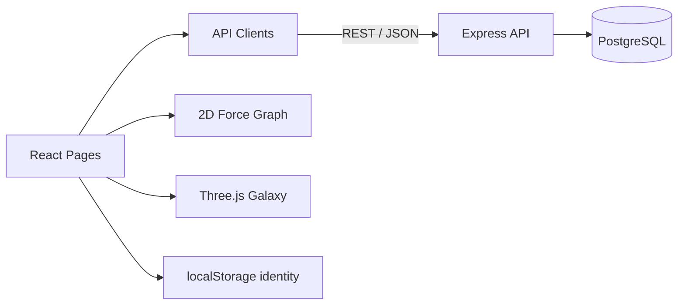

# Stellar Archive · 星際檔案館

Stellar Archive 是一個以「星際航行」為世界觀的 AI Skill / Prompt 探索平台。內容分類被設計成 Galaxy，單一 Skill / Prompt 被設計成 Planet；使用者可透過 2D 星圖或 3D 銀河探索內容、查看詳情並建立自己的 Voyage Map。

- 線上網站：[2026NodeClass.github.io/frontend](https://2026nodeclass.github.io/frontend/)
- Backend：[2026NodeClass/backend](https://github.com/2026NodeClass/backend)

## 產品功能

- 首頁與一致的星際探索視覺語言
- Canvas 力導向 2D 星圖，可依 galaxy、type 與 keyword 篩選
- Three.js 3D 銀河瀏覽
- Planet Detail、同 galaxy 推薦與內容複製
- 註冊、登入、登出與身份狀態
- 會員收藏與 Voyage Map
- 管理者 Galaxy / Planet CRUD
- 串接 PostgreSQL backend，不再只依賴前端 mock data

## 技術棧

| 分類 | 技術 |
| --- | --- |
| Framework | React 19、Vite 8 |
| Routing | react-router-dom 7 |
| API | Fetch、Axios、JWT Bearer Token |
| 3D / Animation | Three.js、GSAP、@gsap/react |
| Visualization | Canvas、自製力導向模擬 |
| Quality | oxlint、Vite production build |
| Deployment | GitHub Pages |

## 架構概覽



```text
src/
├── api/                     # catalog / favorites API clients
├── hooks/                   # identity / favorites state
├── components/              # 共用 HUD、星空、游標與頂列
├── pages/
│   ├── Explore.jsx          # 2D 星圖與資料篩選
│   ├── Galaxy3D.jsx         # 3D 銀河
│   ├── PlanetDetail.jsx     # 單筆內容與收藏
│   ├── VoyageMap.jsx        # 個人收藏
│   ├── Login.jsx            # 登入
│   ├── Register.jsx         # 註冊
│   └── AdminConsole.jsx     # 管理後台
└── App.jsx                  # Route 組裝
```

## Andy Lin 負責的部分

Andy 負責讓 Explore 與 PlanetDetail 從靜態資料切換到團隊的 PostgreSQL backend：

- 建立 `src/api/catalog.js`，集中管理 API base URL、JSON 解析與錯誤處理
- 使用 `Promise.all` 平行讀取 galaxies 與 planets
- 將 2D 星圖、節點數量、galaxy filter 改為依 API response 動態生成
- 以 route parameter 讀取單一 planet 與同 galaxy 推薦
- 使用 `AbortController` 取消已失去作用的 request
- 加入 loading、API failure 與資料缺失的 UI 狀態
- 同步在 backend 實作 public catalog routes、參數化搜尋與 404 / 400 回應

可驗證紀錄：

- [Frontend commit `83372df`](https://github.com/2026NodeClass/frontend/commit/83372df2934e2554d1a825cd31b3d196c3eb1e5d)
- [Frontend PR #2](https://github.com/2026NodeClass/frontend/pull/2)
- [Backend commit `f6b6036`](https://github.com/2026NodeClass/backend/commit/f6b6036b486d8358124a9e93deb57af6996b2325)
- [Backend PR #1](https://github.com/2026NodeClass/backend/pull/1)

## 如何使用 Vibe Coding

Andy 在這個專案中把 AI 當成 codebase 導覽、第一版實作與 review 輔助工具，而不是替代驗證：

1. 先讓 AI 比對 `dev.md`、schema、seed、entities 與舊前端資料，釐清團隊改名與欄位契約。
2. 把任務切成 backend catalog API 與 frontend integration 兩個可獨立驗收的 PR。
3. 人工決定 SQL 安全、HTTP 狀態碼、API response shape 與 React request lifecycle。
4. AI 協助產生初版 route / controller / client，人工逐段檢查 diff 與責任範圍。
5. 以 migration、seed、Node test、frontend build、lint 與實際 request 驗證。
6. 只主張 Git 歷史可證明的貢獻；登入、收藏、管理後台與 3D 銀河屬其他組員成果。

詳細案例：[Backend Vibe Coding Case Study](https://github.com/2026NodeClass/backend/blob/main/docs/ANDY_VIBE_CODING.md)

## 開發

需求：Node.js 20 以上。

```bash
npm ci
npm run dev
```

建立正式版本並執行程式檢查：

```bash
npm run build
npm run lint
```

環境變數：

```dotenv
VITE_API_URL=http://localhost:3010/api
```

## 團隊協作紀錄

下列是依 Git 歷史整理的代表性分工，不代表每位成員的全部貢獻：

| 成員 | 代表性範圍 |
| --- | --- |
| Andy Lin | 公開 catalog API、Explore / PlanetDetail 串接 |
| SuMaoXiong | 資料庫與管理端、部署及整合 |
| JeremyC8891 | 註冊登入、登出與未登入權限處理 |
| YinChe | Three.js 3D 銀河與 VoyageMap 串接 |

## 已知限制與改善方向

- production bundle 目前接近 1 MB，應以 dynamic import 拆分 Three.js 與管理頁面。
- 前端缺少 component / integration tests；至少應覆蓋 catalog 載入、搜尋、未登入收藏與 API failure。
- API client 目前同時使用 Fetch 與 Axios，可逐步統一錯誤格式與 token handling。
- Skill / Prompt 還缺作者、來源、license、Agent 相容性、版本與更新時間等可信度資料。
- 部署流程應加入 build、lint、test 與 smoke test，而不只確認頁面能開啟。
